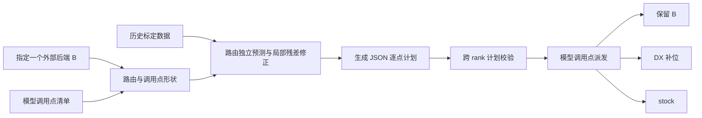

# Stotaway：面向既有重叠后端的预测与 DX 补位系统

本文档整理论文定位、实际算法、相关工作的关系、已有八卡证据与可直接改写的论文表述。它依据本地论文、代码和实验结果撰写；其中的论文名称及模块名称均为建议，不代表代码新增的功能。证据地图见 [refs/evidence-map.md](refs/evidence-map.md)，论证结构见 [段落蓝图](plan/chapter-blueprints/position-blueprint.md)。

## 1. 一句话定位

**Stotaway 是一个面向张量并行计算通信重叠的选择与补位系统：固定一个既有重叠后端，依据执行路由和投影形状预测各候选的相对收益，为模型各调用点生成可执行计划，在合适的位置保留该后端、使用 DX，或回退 stock。**

例如，以 Triton-distributed 为既有后端时，对每个调用点考虑 `{stock, Triton-distributed, DX}`；对 FlashOverlap 则考虑 `{stock, FlashOverlap, DX}`。一次计划只固定一个外部后端，不把 Flux、FlashOverlap、Syncopate 等不同外部技术同时混进一个模型方案。这里的 stock 是相应 AG→GEMM 或 GEMM→RS 的顺序执行。

这套系统的中心问题是：**当某种重叠后端已经存在时，哪些位置应当保留它，哪些位置应采用 DX 或 stock，才能得到更好的实际执行方案？** 预测器负责做选择，DX 是可供选择的补位实现，适配器将计划落到训练和推理的实际调用点。论文的结果既包含重叠算子，也包含计划执行后的模型耗时。

图中的三个出口是每个调用点的候选；具体工作负载未必会同时使用三个出口。当前八卡模型实验使用预先生成的计划，而不是逐次调用时实时运行预测器。

建议英文标题：

1. **Stotaway: Predictive Backend Selection and Direct-Exchange Substitution for Compute–Communication Overlap**
2. **Stotaway: Route-Aware Selection and Direct-Exchange Substitution for Tensor-Parallel Workloads**
3. 中文：**Stotaway：面向张量并行的重叠路径预测与直接交换补位系统**。

这里的 *backend selection* 指固定目标后端之后，在该后端、DX 和 stock 中选路；在摘要或方法开头应说明这一点，避免读者误解为同时拼接所有外部后端。

## 2. 论文问题从哪里来

张量并行模型中 QKV、输出投影、FC1 和 FC2 的形状、依赖方向不同。AG 是先使输入可用再计算，RS 是先产生部分输出再通信；二者的重叠窗口、分块矩阵乘法效率以及通信和同步成本不同。重叠可能减少暴露的通信，也可能引入更小 GEMM、额外等待、复制或输出布局转换。对同一个模型，统一开启某一个方法不一定是最佳选择。

八卡数据给出这个问题的直接动机：

- Async-TP 的 BF16 算子表中，AG 66/66 点相对各自 stock 大于 1×，RS 0/33 点大于 1×；DX 的 BF16 重测和历史数据中，RS 的优势更明显。两者按各自 stock 归一化，说明互补趋势，不能把不同批次的绝对耗时直接当作配对比较。
- Triton-distributed 的三类形状表现也不一致；Llama 模型实际计划既保留了 Triton-distributed 的 QKV AG，又在 RS 上选用 DX，并对 FC1 使用 stock。
- FlashOverlap 的实际模型接入需要恢复 tile 与 rank 布局，转换成本会影响一个算子接进模型后的收益。当前 BF16 接入测试中 Qwen 和 Llama 的四个 RS 形状都通过输出对照，speedup 分别为 Qwen 0.803×/0.878×、Llama 0.968×/1.021×，这些数字包含布局转换。

因此适合论文强调的是**收益具有调用点和实际执行路径依赖性，选择需要与执行语义一起考虑**。这不是一条对所有设备都成立的新物理定律，而是本研究的数据支持的系统问题。

## 3. 建议的三个贡献点

### 贡献一：固定外部后端的调用点补位框架

构建统一候选接口，把每个投影位置映射到固定后端 B、DX 或 stock。该接口在系统层面统一算子语义与输出分片，并针对不同实现处理上下文创建和结果布局。计划使用 JSON 指定 `site/op/M/N/K/choice`，TP8 的多后端执行器验证各 rank 的计划摘要，按精确形状派发；未知形状使用 stock。

可强调的工程价值是：**同一个执行框架覆盖 CUTLASS+NCCL 与 Triton/NVSHMEM 等不同实现路径，使用同一计划结构描述可执行替换**。这是接口与系统集成层面的贡献，不等于系统能自动解析任意仓库或自动探测所有 GPU kernel。route 结构记录硬件、软件、通信、计算和计时信息；当前生产计划加载器实际校验的字段以代码为准，不能写成所有 route 元数据在运行时都被自动验证。

- 代码：`stowaway_nvidia/multi_backend8.py`、`stowaway_nvidia/auto_plan8.py`、`stowaway_nvidia/external_tp8.py`。
- 训练与推理接入：`experiments/megatron_async_prelude.py`、`stowaway_nvidia/vllm_multi_tp8.py`。
- 真实组合证据：Async-TP 和 Triton-distributed 计划均有外部路径与 DX 的实际模型命中；Syncopate 和 FlashOverlap 的当前自动计划均为 stock+DX，不应称它们在自动方案中仍有外部路径命中。

### 贡献二：路由隔离的相对收益预测与邻域修正

实际八卡预测器不是凭名称写规则，而是对一个固定执行路由、通信方向和目标方法，独立拟合其相对 stock 的收益：

\[
y_{r,i}=\log\frac{T_{\text{stock},i}}{T_{r,i}},\qquad
x_i=(\log M_i,\log N_i,\log K_i).
\]

先对 `x` 标准化，并用岭回归预测 `y`，正值表示预计候选快于 stock。不同方法和 AG/RS 分别拟合；完整 route 记录方法、计算与通信路径、内存、同步、设备、拓扑、TP、dtype、版本和计时口径等上下文。对于本次实际 LOMO 主实验，回归的数值输入是 **log(M,N,K)**；通信、tile、SM 等信息是可记录的路由元数据或后续特征，不能说本轮全部作为数值特征训练。

为了减少单一全局线性回归对局部形状的误差，`RouteLocalResidual` 使用按模型族留出的残差构建支持集。在训练集内部，对于每个模型族先用其余模型族拟合基础模型，得到该族的折外残差 `e_j`；对待预测形状 `q`，在标准化的 log 形状空间查找来自不同模型族的近邻，取至多 3 个，按距离倒数加权，并以 0.5 收缩：

\[
\widehat y_r(q)=f_r(q)+0.5\,
\frac{\sum_{j\in\mathcal N(q)} e_j/(0.25+d_j)}
{\sum_{j\in\mathcal N(q)}1/(0.25+d_j)}.
\]

其中 `d_j` 是按训练集尺度标准化后的 log 形状欧氏距离；同一模型族只取一个近邻。计划对每个调用点计算

\[
a_i=\arg\max_{a\in\{\text{stock},B,DX\}}\widehat y_{a,i},
\quad \widehat y_{\text{stock},i}=0.
\]

FlashOverlap 当前只对支持的 RS 投影进入外部候选。输入及候选不兼容时执行 stock。需要注意：上述式子是**逐点相对收益最大化**；本轮八卡 JSON 计划没有在导出时求解包含交互项的全局模型，也没有证明线上净收益优化。`unified_step.py` 中有另一套整步原型，不能将其性质自动归到本轮实验上。

可以称本贡献为**面向重叠路由的相对收益建模与族外残差修正的组合**。岭回归、最近邻、对数收益和分组验证本身是已有通用方法，论文需要重点解释这些设计怎样针对异构重叠路径和目标选路任务组合，并用消融与对照说明每部分的作用；目前还没有充分证据把该组合宣称为全新预测理论。

- 基础回归与 route：`planner/original_a800/orthogonal_predictor.py`。
- 局部残差：`planner/original_a800/route_local_residual.py`。
- 主计划：`planner/original_a800/export_tp8_auto_plan.py`，另有 Syncopate/FlashOverlap 导出脚本。

### 贡献三：可供补位的直接交换 DX

TP8 DX 使用 NVSHMEM 对称缓冲提供可访问的 peer 存储，按 peer 分块使用 `torch.matmul` 执行 GEMM，以 CUDA 异步 peer copy 和 stream wait 重叠发送与计算，并使用 ticket/ACK 保证缓冲复用顺序。RS 在收到各 rank 的部分结果后，使用 Triton kernel 求和；shift 排序和批量 ACK 是本次 DX8 实现配置。

论文可把 DX 描述为**可与多种既有后端在统一计划中互换的直接交换候选**，突出其实现与路径语义，而不写成“所有计算都是 Triton”或“数据传输全由 NVSHMEM put 发起”。分块、DMA、异步同步及重排序已有相关工作，单独以这些概念宣称首创证据不足。当前数据尤其支持 DX 在所测 RS 形状中作为候选的价值，同时 AG 中它并非普遍更快。

代码：`stowaway_nvidia/dx8.py`、`stowaway_nvidia/runtime.py`。DX BF16 历史值和重测值见 [DX 算子重测对照](../../results/八卡DX算子重测对照_20261114.md)。

## 4. 相关工作：如何说清差别

| 研究 | 本地材料中可确认的重点 | 在本文的比较方式 |
|---|---|---|
| [Flux](https://arxiv.org/abs/2406.06858) | 面向 GPU 的 GEMM/通信细粒度融合，论文覆盖训练和推理 | 将其作为重叠实现代表与潜在后端；不能声称其没有 E2E，也不能把已有四卡资料说成本次 A800 八卡同配置对比。 |
| [FlashOverlap](https://arxiv.org/abs/2504.19519) | signaling、reordering 与预测 wave 分组；源码已有 `predict_lat` 流水线预测 | 对方重点是该实现内分组；本文额外研究固定 B、DX、stock 的调用点候选和可执行适配。流水线 max 递推与预测搜索不能当作本文独创。 |
| [Triton-distributed](https://arxiv.org/abs/2504.19442) | 提供分布式编程与重叠 kernel 的编译支持 | 本文将其作为可调用后端，并针对具体形状决定保留/补位；不能声称统一分布式 kernel 或 autotune 首创。 |
| [Syncopate](https://arxiv.org/abs/2601.20595) | chunk 抽象、Triton 代码变换、自动调参，并可组合外部通信计划 | 本文实测其 A800 适配路径，研究固定该后端时的候选选择；不应概括为它没有规划、没有自动调参。 |
| [FiCCO](https://arxiv.org/abs/2512.10236) | DMA 细粒度重叠，基于计算/通信特征选择 schedule | 与 DX 及预测部分都强相关；必须比较具体候选、粒度与平台，不能把特征驱动选择、GEMM+DMA 宣称首创。 |
| [TokenWeave](https://arxiv.org/abs/2505.11329) | 推理时 token 分块、wave-aware 调度和融合 | 说明推理重叠和 wave 调度已有先例；具体硬件和方法不同。 |
| [Centauri](https://doi.org/10.1145/3620666.3651379) | 当前仅有其他论文的二手描述，涉及通信分区与分层调度 | 是必须继续查全文的相近工作。暂不下结论称其不支持某种整步规划或已经确认不撞车。 |

最稳妥的差异表述：**现有工作提供多种重叠实现、编译与各自调优策略；本文以固定既有方法为接入对象，把其与一个自带的 DX 候选、stock 合并为逐调用点选择问题，并实现多种路径的模型执行。** 这表达的是目前代码和已查阅材料中的研究范围，不是“全领域首个”的结论。特别是 Centauri、Mercury、Alpa、Domino 等需在投稿前进一步检查，以判断有无直接相同的候选替换系统。

## 5. 实验如何支撑论证

### 5.1 算子覆盖与补位动机

在单机 8×A800-SXM4-80GB、TP8 上，11 组模型维度、三种投影、M∈{8192,16384,32768}：Async-TP、Triton-distributed、Syncopate、DX 各有 99 点；FlashOverlap 有 33 个 RS 点。Async-TP/Triton-dist/DX 主矩阵为 BF16，Syncopate/FlashOverlap 原矩阵为 FP16。

FlashOverlap 的 33 点由 23 个原生内核计时和 10 个包含布局恢复的派发计时组成，口径不同。DX BF16 99 点本轮重测，其中 36 点高于旧值，按要求在主表取较高值；此择高表有选择偏差，适合展示当前测得的较高值，**预测器训练和泛化评估应使用预先确定的原始批次**，不能将事后择高值当无偏测量。

论文图建议把 AG 和 RS 分开：横轴为各形状或模型族，纵轴为相对本次各自 stock 的 speedup，并清楚标 dtype、时间口径及布局恢复。优先展示固定协议的完整分布或完整表，代表性维度可以突出 DX 的补位区间，但也要保留完整结果附件；不能只挑优势点后声称在所有形状领先。

### 5.2 算子预测：正确率之外还要看简单基线

下表从现有四份 LOMO JSON 的逐点数值重新计算。几何平均均基于该评估内部的归一化值，属于开发评估。`oracle` 是根据这些已测值逐点事后取最好候选。

| 固定 B / 评估范围 | 选择正确率 | 全用 B 几何平均 | 全用 DX 几何平均 | 预测选择几何平均 | 事后 oracle 几何平均 | 预测选择低于 stock |
|---|---:|---:|---:|---:|---:|---:|
| Async-TP，BF16，99 点 | 96/99（96.97%） | 1.140× | 0.990× | 1.266× | 1.269× | 1 |
| Triton-distributed，BF16，99 点 | 85/99（85.86%） | 1.073× | 0.990× | 1.147× | 1.157× | 6 |
| Syncopate，FP16，99 点 | 89/99（89.90%） | 0.535× | 1.108× | 1.108× | 1.118× | 8 |
| FlashOverlap，FP16，33 个 RS | 27/33（81.82%） | 1.098× | 1.196× | 1.185× | 1.217× | 3 |

**对结果的解读：** Async-TP 和 Triton-dist 的预测选择相对 always-B/always-DX 的几何平均都有明显提高，支持按点选路的动机。Syncopate 当前 oracle 的 99 个点里 88 个选 DX、11 个选 stock，预测器 94 个点选 DX、5 个选 stock，因此 89.90% 的结果部分来自类别集中；其预测选择与 always-DX 几何平均几乎相同。FlashOverlap 的预测选择在该评估中低于 always-DX（1.185× 对 1.196×），不能说预测器在这组数据上优于最强固定策略。正确率大于 80% 本身也不能说明收益最大或稳健。

LOMO 按模型名称留出，检查了相同方向、完全相同 MNK 没有跨其他模型重复；相近形状仍可能存在，且数据参与过开发，所以称“按模型留出的开发评估”，不称最终独立盲测。候选来自不同批次、各自 stock 归一化；Syncopate/FlashOverlap 的 FP16 DX 使用另批 stock，FlashOverlap 还混有布局口径，故 oracle 是近似标签而非严格同进程三臂 oracle。原始文件列在 [证据地图](refs/evidence-map.md)。

### 5.3 训练和推理端到端

下面给出纯后端与对应自动方案的**独立运行结果**。Qwen3.6-27B：64 层文本配置，TP8 BF16，seq4096，MBS2/GBS2，全重算，随机初始化和 mock data；12 步取第 4–12 步中位。Llama3-70B：真实权重，完整 80 层，TP8 BF16，M=16384；记录 TTFT、2M TTFT、16 请求总时长。完整配置与命中见 [端到端表](../../results/单机8卡端到端与预测器结果_20261113.md)。

| 固定后端 B | Qwen B → 自动，ms/步 | 自动相对 B | Llama TTFT B → 自动，ms | 自动 TTFT / 2M / 16 请求相对 B |
|---|---:|---:|---:|---:|
| Async-TP | 2114.2 → 1997.4 | 1.058× | 1632.6 → 1611.8 | 1.013× / 1.007× / 1.014× |
| Triton-distributed | 2011.0 → 1991.3 | 1.010× | 1869.0 → 1696.4 | 1.102× / 1.090× / 1.104× |
| Syncopate | 2739.3 → 2102.2 | 1.303× | 3417.1 → 1797.7 | 1.901× / 1.791× / 1.886× |
| FlashOverlap，仅 RS 后端 | 2197.6 → 2096.5 | 1.048× | 1895.4 → 1781.5 | 1.064× / 1.065× / 1.070× |

每组纯后端与自动方案均有实测日志，但各自为独立进程的一轮；Llama 的同类手工与自动计划命中相近却存在明显波动。上表展示当前测得的结果，尤其 1% 左右差异不应称稳定收益。Syncopate 的 A800 数据是本仓库适配路径的结果，不能写成其在所有 GPU 上均有相同表现；FlashOverlap 模型基线是 BF16 工作副本，仅替换 RS，并计入布局转换。

训练的 Syncopate/FlashOverlap 自动方案、推理的同两组方案都实际选择 AG=stock、RS=DX；相对原后端的改善包括避开较慢路径的效果，不能描述为运行时同时保留了该外部后端。Syncopate/FlashOverlap 模型自动计划的外部候选模型使用 FP16 标定，实际 E2E 为 BF16；第 5.2 节 FP16 同精度 LOMO 是另一项评估，并非证明了 BF16 E2E 计划的同精度准确率。

### 5.4 可验证的论文证据链

1. **需求存在**：完整算子表展示不同方法在 AG、RS、不同形状上的收益差异。
2. **能给出计划**：路由建模与 LOMO 结果说明系统可以为指定 B 输出逐点候选，报告 accuracy、selected speedup、always-B、always-DX 和 oracle。
3. **计划真的执行**：模型日志记录 QKV/proj/FC1/FC2 的实际路径命中；FlashOverlap 的正确性检查覆盖布局恢复。
4. **模型级有实测改善**：同模型配置下列出纯后端和自动方案的实际耗时与比值，不将算子几何平均替代模型速度。
5. **可追溯**：实验输入、预测 JSON、时间和原始数据分开保存；对 DX 的择高展示另外列出原始旧值和新值。

## 6. 可直接改写的论文文本

### 摘要草案

> 张量并行中的计算通信重叠方法在不同算子形状和通信方向下可能表现不同，统一采用同一执行路径会使部分调用点受到分块计算、同步或数据布局转换的额外开销影响。我们提出 Stotaway，一个面向既有重叠后端的调用点选择与直接交换补位系统。对于用户指定的一个后端，Stotaway 以算子形状和执行路由为输入，独立估计该后端与直接交换实现相对顺序执行的收益，结合模型族留出残差进行局部修正，并输出可由多 GPU 一致加载的执行计划。该系统为 AG/GEMM 和 GEMM/RS 提供直接交换候选，并通过后端适配器处理不同实现的通信与输出布局。在单机八卡 A800 上，我们对 11 组模型维度进行了算子级评估，按模型留出的四类后端选择准确率为 81.82%–96.97%。在 Qwen3.6-27B 训练配置和 Llama3-70B 推理中，系统运行了针对 Async-TP、Triton-distributed、Syncopate 与 FlashOverlap 的独立计划；相对于相应后端基线，观察到训练 1.010×–1.303× 及推理 TTFT 1.013×–1.901× 的速度比。实验使用固定测试配置，不同后端与不同精度的评估口径见正文。

摘要定稿应按目标会议字数和最终验证范围调整。这里的结果是所测配置、独立运行的观察值；范围端点属于不同后端，不是一个普适性能区间。若摘要空间允许，应加上 Qwen 随机初始化和 FlashOverlap 仅 RS 的说明，或在实验章节显著说明。

### 引言的贡献段落草案

> 为利用不同重叠实现对算子形状和通信方向的不同适应性，我们将重叠部署建模为固定既有后端下的调用点选择问题。在每个投影位置，系统从既有后端、直接交换路径和顺序执行中选择候选，并生成可重复加载的多 GPU 执行计划。Stotaway 为不同计算和通信实现提供统一的路径表示与适配接口，通过各路径独立的相对收益模型和模型族留出残差修正预测候选收益，并实现直接交换路径作为补位候选。我们在八卡 A800 的多模型算子及训练、推理工作负载上评估选择行为、实际路径命中与模型性能。

### 方法介绍草案

> 对每个给定后端及通信方向，Stotaway 从该路径的标定样本学习顺序执行时间与候选执行时间的对数比值。该表示使不同规模的调用点能够通过相对收益比较，并将顺序执行对应为零收益。为了利用相似形状的信息，我们在训练集内部按模型族生成折外残差，再对不同模型族的形状邻居进行收缩加权修正。系统将外部后端、DX 和顺序执行的估计收益映射为每个调用点的计划选择。运行时各 rank 验证计划摘要，按调用点和精确形状执行已准备的上下文；FlashOverlap 等需要转换输出布局的路径由适配器恢复模型所需的分片。

### 贡献列表草案

1. 提出固定既有重叠后端的调用点选择与补位问题，设计可表达外部后端、DX 和顺序执行的统一计划及适配接口。
2. 设计按执行路由隔离的相对收益模型和模型族折外邻域残差修正，用于根据 MNK 等已知信息生成选择计划。
3. 实现基于 peer 分块、异步复制和同步的直接交换候选，并将所选计划接入 Megatron 训练及 vLLM 推理；在单机八卡 A800 上评估算子选择及模型执行效果。

论文可将贡献 1 和 2 写为系统与算法两部分，将贡献 3 写为实现和评估；不要将“提出世界首个预测器”作为贡献标题。

## 7. 建议论文结构、图表和叙事

| 章节 / 图表 | 内容 | 应放的证据 |
|---|---|---|
| Introduction | 先讲统一启用重叠可能因方向/形状和布局产生不同净效果，再引出固定 B 的补位 | Async-TP AG/RS 对比、FlashOverlap 布局转换与实际模型结果 |
| Background / Motivation | AG 与 RS 依赖图，计算切分、同步、通信资源、重排的成本 | 代码和同条件实测，标注批次 |
| System overview，图 1 | `指定 B + 工作负载 → route/shape 建模 → B/DX/stock 计划 → 多 rank 派发 → Qwen/Llama` | 计划 schema、rank digest、实际命中 |
| Prediction，算法 1 | 分 route 拟合 log 收益，模型族 OOF 残差，三个不同族邻居加权，逐点 argmax | 第 3 节公式和实现文件 |
| DX 与 adapters，图 2 | AG/RS 分块、peer copy、ticket/ACK；Flash 布局转换示意 | DX 代码，明确厂商 GEMM 与 Triton 归约各自职责 |
| Evaluation，表 1 | 硬件、软件、模型、TP、dtype、计时、layout | 实验记录及逐行环境 |
| Evaluation，图 3 | 多模型算子分布：每个 B 与 DX/stock；AG、RS 分开 | 多后端算子表，原生与派发计时口径分开 |
| Evaluation，表 2 | LOMO accuracy、always-B/DX、预测、oracle、慢点 | 第 5.2 节完整表与原始 JSON |
| Evaluation，表 3 | Qwen 训练和 Llama 推理的 B/自动耗时、对 B 和 stock 的比值、实际命中 | 第 5.3 节；标明 mock/真实权重和 FP16→BF16 |
| Discussion / Related work | 重叠实现、调优和系统规划的对应关系；现有能力与直接先例 | 第 4 节及证据地图 |

若版面有限，主图展示完整分布的摘要而非只展示胜出的点；逐点数据作为附录。E2E 的相对 stock 和相对 B 都应出现，否则读者无法判断是替换收益还是原后端本身的收益。

## 8. 与原版的关系及论文可主张的边界

BW1000 原版已经有 G、通信成本、stock/DX 候选和保守门；本论文应说 NVIDIA 版本将固定自有路径的规划扩展为**面向多种固定外部后端的统一候选和可执行适配**，并实现按路由收益与邻域残差的预测实验。它不是从零首次提出按性能决定是否重叠。

当前能够直接支撑的结论是：

- 在所测 A800 TP8 模型算子中，不同重叠路径的收益随方向和形状变化，存在可利用的补位机会。
- 统一计划和四种外部后端的目标模型基线都执行过；其中 Async-TP 和 Triton-dist 自动方案确实同时命中外部路径和 DX，其他两种在所测自动计划中选择 stock 和 DX。
- 四组 LOMO 开发评估的准确率均超过 80%，但收益不一定超过 always-DX；模型 E2E 的几组独立运行观察到相对后端的加速。

当前不应写成：DX 覆盖所有形状且必定超过 1×；所有自动方案都保留原后端；预测器自动识别任意后端；所有数据都是同 dtype/同口径/同批；本系统已实现运行状态实时监测、全局交互建模和已实证回本；所有既有研究都没有类似思路；以及单凭这些结果可以确定录取 CCF A。强结论需要直接对应测量。

## 9. 投稿前优先补强项（不影响本次已整理结果）

1. **相关工作查全**：直接获取并阅读 Centauri、Mercury 等全文，对照是否在固定外部后端的逐调用点替换、候选语义、成本建模和实际框架集成方面已有直接先例。
2. **预测器消融及简单策略**：完整报告 always-stock、always-B、always-DX、oracle；对比基础回归与邻域残差，分别报告收益、误选损失和低于 stock 的点。需要在保留开发数据的基础上区分独立冻结测试。
3. **确认净收益与重复性**：把计划生成、初始化、布局转换和重配开销分别量化；对小幅 E2E 差异做多次独立交错测量，报告波动与 amortization。现有 E2E 为一轮独立运行，不把每一步计时当作独立进程重复。
4. **一致性验证**：为关键 BF16 模型形状使用同 dtype、同执行路径和含布局成本的标定，区分与当前 FP16→BF16 自动计划的关系；如希望主张完全统一的 33 点 Flash 算子比较，需统一其 23+10 点的计时口径。

这些是面向最终论文说服力的补强方向，不意味着必须重复本轮全部实验。当前单卡/CPU 已足够进行文献核查、结果分析、论证组织和论文写作。
