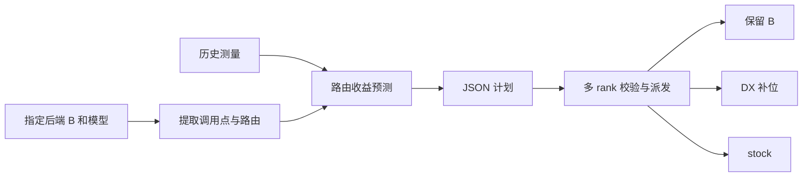

# Stotaway 系统定位与论文包装：精要版

## 一句话定位

**Stotaway 是一个面向既有计算通信重叠后端的预测选择与 DX 补位系统。** 对用户指定的一个外部后端 B，它根据模型调用点的形状和执行路径，预测保留 B、采用 DX 或顺序执行（stock）的收益，生成逐点计划，并在训练或推理中实际派发。

这里的“指定一个外部后端”是关键。以 Triton-distributed 为例，候选为 `{Triton-distributed, DX, stock}`；换成 FlashOverlap 时，候选变为 `{FlashOverlap, DX, stock}`。不是把 Flux、FlashOverlap 等多个外部后端一起拼成一个计划。一个具体方案也不一定会命中全部三个候选。

## 论文故事

1. **问题**：张量并行中的 AG+GEMM 和 GEMM+RS 具有不同的数据依赖；QKV、输出投影、FC1、FC2 的形状也不同。重叠减少通信等待的同时，可能引入分块 GEMM、同步和布局转换开销，因此同一后端在不同调用点的收益并不一致。
2. **机会**：既有重叠后端在部分位置有优势，DX 在另一些位置有优势，stock 也可能更快。系统应为固定后端找到合适的逐点执行方案。
3. **方法**：用路由与形状建立各候选的相对收益预测，选择每个调用点的候选，生成 JSON 计划；运行时校验多 rank 计划并调用匹配的上下文。
4. **执行**：DX 提供可选择的直接交换路径；适配器对外部后端的通信和输出布局进行衔接。
5. **证据**：用完整算子结果说明互补，用按模型留出评估说明选择能力，用实际路径命中和模型端到端耗时说明计划可以运行。

当前八卡实验使用预先生成的计划；不把它写成每次调用都实时探测并重新规划。

## 建议贡献

### 1. 系统：固定后端的可执行补位

统一表示通信方向、形状、数据类型、计算与通信实现等路由信息，提供每个调用点的 `{B, DX, stock}` 候选，输出可加载的计划并在模型框架中执行。重点是**统一选择接口与语义衔接**，包括实际输出分片和必要的布局转换。

当前实现支持已接入的路径；不能据此说系统能自动分析任意源码或自动接入任何重叠库。路由描述中的完整元数据也不能全部视为运行时已经强制验证的字段。

### 2. 算法：路由隔离的相对收益预测

对每个方法和通信方向分别预测：

`收益 = log(stock 耗时 / 候选耗时)`。

当前八卡算法使用 `log(M), log(N), log(K)` 的岭回归，利用训练集内按模型族留出的残差，在不同模型族的形状邻居上做收缩加权修正，然后在 stock、B、DX 的预测收益中逐点选最大值。核心代码是 `planner/original_a800/orthogonal_predictor.py`、`route_local_residual.py` 和 `export_tp8_auto_plan.py`。

适合称为**面向异构重叠路由的相对收益建模与跨模型族局部修正**。岭回归、近邻、对数收益和留出评估本身都有通用先例；论文要通过算法组合、任务定义与实验消融说明贡献。当前八卡计划是逐点选择，没有证据证明已实现带交互项的全局最优规划。

### 3. DX：系统自己的补位候选

八卡 DX 用 NVSHMEM 对称缓冲提供 peer 存储，按 peer 分块调用 `torch.matmul`，以 CUDA 异步 peer copy 和流等待配合计算，使用 ticket/ACK 管理复用，并用 Triton 完成 RS 归约。其价值是提供了一个可接入统一计划的实际候选，尤其在所测 RS 形状上有补位机会。

论文不应把它写成“全程 Triton GEMM”或声称“所有传输都是 NVSHMEM put”；GEMM、复制、同步和归约的具体职责应按实现说明。分块、DMA、同步与重排序都有已有工作，DX 的贡献应以具体实现组合和实验结果论证。

## 实验如何讲

| 证据 | 结果 | 它说明什么 |
|---|---|---|
| 八卡算子 | Async-TP/Triton-dist/Syncopate/DX 各 99 点；FlashOverlap 33 个 RS 形状 | 不同方向和形状下的收益差异与可选择空间 |
| 八卡预测，按模型留出的开发评估 | Async-TP 96/99；Triton-dist 85/99；Syncopate 89/99；FlashOverlap RS 27/33 | 在当前数据上选择正确率为 81.82%–96.97% |
| Qwen 训练自动方案相对对应 B | Async 1.058×；Triton-dist 1.010×；Syncopate 1.303×；FlashOverlap 1.048× | 四种指定后端的计划在所测训练配置下运行 |
| Llama 推理 TTFT 自动方案相对对应 B | Async 1.013×；Triton-dist 1.102×；Syncopate 1.901×；FlashOverlap 1.064× | 四种指定后端的计划在所测推理配置下运行 |

完整耗时、2M 和 16 请求数据见 [端到端表](../results/单机8卡端到端与预测器结果_20261113.md)。Async-TP 和 Triton-dist 自动方案实际保留了部分外部路径并使用 DX；所测 Syncopate 和 FlashOverlap 自动方案选择的是 stock+DX。Qwen 是 64 层文本配置、随机初始化和 mock 数据；Llama 使用 70B 真实权重和完整 80 层。E2E 对照是独立进程的一轮结果。

预测器不能只报正确率：Syncopate 的预测选择几何平均约 1.108×，与全用 DX 几乎相同；FlashOverlap RS 的预测选择约 1.185×，低于全用 DX 的 1.196×。这说明在这些评估中，简单固定策略是必须列出的重要对照。原评估候选来自不同批次，FlashOverlap 的 23 个原生点和 10 个派发点的布局计时口径不同；这些是开发评估，不能冒充同批次独立盲测。

## 与相关工作的差别

Flux、FlashOverlap、Triton-distributed、Syncopate、FiCCO 等已经分别研究重叠实现、代码生成、预测搜索或调参。本文应强调的是：**在指定一个已有后端的前提下，将它和 DX、stock 作为候选，跨模型调用点生成并执行补位计划**。FlashOverlap 的流水线预测和 FiCCO 的特征驱动 schedule 选择已有先例，不能把预测、DMA 或 max 递推单独称为首创。

当前资料不足以证明没有直接撞车；Centauri、Mercury 等相近工作仍需进一步核对。建议论文同时提供 always-B、always-DX、stock、oracle、预测选择和算法消融；对关键小幅端到端结果做独立重复并量化规划及布局成本。

## 标题和摘要句式

- **Stotaway: Predictive Backend Selection and Direct-Exchange Substitution for Compute–Communication Overlap**
- **Stotaway：面向张量并行的重叠路径预测与直接交换补位系统**

摘要可以写：

> 我们提出 Stotaway，一个面向既有重叠后端的逐调用点选择与直接交换补位系统。系统对指定后端、直接交换和顺序执行分别估计相对收益，结合按模型族留出的局部残差修正生成可执行计划，并通过后端适配在多 GPU 训练和推理中执行。单机八卡 A800 的算子开发评估和模型实验展示了不同重叠路径的互补性，以及在所测配置下相对于对应后端的性能变化。

更完整的算法公式、结果表、相关工作和论文结构见 [详细创新论证](论文创新论证_20261114/预测器与DX系统_创新性论证及论文包装.md)，出处见 [证据地图](论文创新论证_20261114/refs/evidence-map.md)。
